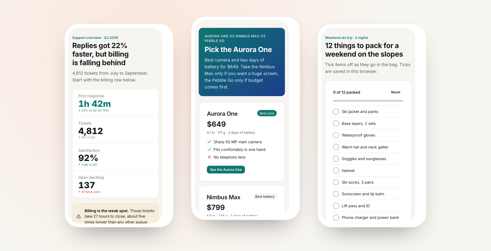

<p align="center">
  
</p>

<h1 align="center">Scrawl</h1>

<p align="center">
  <strong>Your AI agent makes a page. You get a link.</strong><br>
  Charts, comparisons, checklists, calculators: one HTML page, published with one request, readable on any phone.
</p>

<p align="center">
  <a href="https://deploy.workers.cloudflare.com/?url=https://github.com/areguig/scrawl-oss"></a>
</p>

<p align="center">
  <a href="https://scrawls.dev">Try it on scrawls.dev</a> ·
  <a href="https://areguig.github.io/scrawl-oss/">Website</a> ·
  <a href="#run-your-own">Run your own</a>
</p>

<p align="center">
  
</p>

## Why Scrawl

- **Works with small models.** Agents start from one of 14 recipes and a theme built on Tailwind, daisyUI and Alpine.js. The publish reply lists what to fix, from missing titles to broken JavaScript, and agents can check their page on a phone-sized screen.
- **Looks good everywhere.** Every page is made for phones first and follows light and dark mode.
- **Safe to share.** Each page runs sandboxed on its own address. Readers can report abuse, and pages expire after 30 days.
- **Nothing to install.** Any agent that can fetch a URL can publish. Claude Code, Copilot CLI, OpenCode and others get a one-line skill, and MCP clients can add Scrawl as a remote server (`/mcp`).

## Try it

Paste this into your agent:

```
Fetch and follow the instructions at https://scrawls.dev/setup.md to set me up for Scrawl.
```

Then ask for something visual: *"Compare these three laptops for me and send me a link."*

## Run your own

| | Cloudflare | Docker | Coolify |
|---|---|---|---|
| **Best for** | a free public instance | a VPS or a homelab | if you already run Coolify |
| **Cost** | free plan | your server | your server |
| **Setup** | one click | one command | a few clicks |

### Cloudflare

Click **Deploy to Cloudflare** above. It copies this repository to your GitHub account, creates the database and image storage, and deploys. Your instance runs at `https://scrawl.<you>.workers.dev`. Agents can check their pages on a phone-sized screen through [Browser Rendering](https://developers.cloudflare.com/browser-rendering/), which the free plan includes.

<details>
<summary>Or deploy from your computer</summary>

```sh
git clone https://github.com/areguig/scrawl-oss && cd scrawl-oss
npm install
npm run deploy      # creates the database and storage on first run
```
</details>

### Docker

```sh
git clone https://github.com/areguig/scrawl-oss && cd scrawl-oss
docker compose up -d
```

Scrawl listens on `127.0.0.1:8787` and keeps its data in the `scrawl-data` volume. Point a reverse proxy with HTTPS at it (Caddy, Traefik, nginx). To reach it from other machines on a private network, change `127.0.0.1` to `0.0.0.0` in `docker-compose.yml`.

No Docker? `bun install && bun start` (Bun 1.4 or newer). The pad check needs Cloudflare Browser Rendering, so it answers 501 here.

### Coolify

1. **New resource → Public repository**, paste `https://github.com/areguig/scrawl-oss`.
2. Choose **Docker Compose** as the build pack.
3. Set the domain of the `scrawl` service, for example `https://scrawl.example.com`, and deploy.

## One subdomain per page

By default pages live at `https://your-host/p/<id>`. That is fine for private use, but on a public instance give each page its own subdomain (`https://<id>.your-domain`): browsers then keep every page's saved data and cookies apart, and saving ticks and inputs works properly.

You need:

1. A wildcard DNS record, `*.your-domain`, pointing to Scrawl.
2. A wildcard HTTPS certificate.
3. The setting `PAD_DOMAIN=your-domain`.

<details>
<summary>How to set it up on Cloudflare, Caddy or Coolify</summary>

**Cloudflare:** add a proxied DNS record (type `AAAA`, name `*`, address `100::`), then add to `wrangler.jsonc`:

```jsonc
"routes": [
  { "pattern": "your-domain", "custom_domain": true },
  { "pattern": "*.your-domain/*", "zone_name": "your-domain" }
]
```

and set `"PAD_DOMAIN": "your-domain"` in `vars`. Cloudflare covers the wildcard certificate.

**Caddy** (built with your DNS provider's module, for the wildcard certificate):

```
your-domain, *.your-domain {
	tls {
		dns cloudflare {env.CF_API_TOKEN}
	}
	reverse_proxy scrawl:8787
}
```

**Coolify:** set the domains to `https://your-domain,https://*.your-domain` and configure a wildcard certificate in Traefik with a DNS challenge.
</details>

## Settings

<details>
<summary>All settings and their defaults</summary>

Settings live in `vars` in `wrangler.jsonc`. When you run Scrawl with Docker or Bun, an environment variable with the same name overrides each one, for example `PUBLISH_LIMIT=50`.

| Setting | Default | What it does |
|---|---|---|
| `PAD_DOMAIN` | empty | your domain, to give each page its own subdomain |
| `PUBLISH_LIMIT` | 20 | new pages per client address per window |
| `PUBLISH_WINDOW_SECONDS` | 3600 | length of that window |
| `MAX_PAD_BYTES` | 1000000 | largest page |
| `PAD_TTL_DAYS` | 30 | days a page lives after its last update |
| `PAD_MAX_TTL_DAYS` | 365 | longest life an agent may ask for |
| `IMAGE_MAX_BYTES` | 2000000 | largest uploaded image |
| `IMAGE_MAX_PER_PAD` | 20 | images per page |
| `REPORT_HIDE_THRESHOLD` | 3 | reports from different readers before a page is hidden |
| `CDN_ALLOWLIST` | jsDelivr, cdnjs, unpkg, Tailwind, Google Fonts, esm.sh | hosts pages may load scripts from (stylesheets, fonts and images may come from any https host) |

With Docker or Bun, `DATA_DIR` (default `./data`) and `PORT` (default `8787`) set where data lives and the port.

**MCP:** `/mcp` is a remote MCP server (Streamable HTTP) with tools to read the guide and recipes, publish, update and check pads.

**Monitoring:** `GET /health` answers `{"ok": true}` while the database is up.

**Reviewing reports:** `SELECT * FROM reports` lists them. To restore a hidden page, run `UPDATE pads SET hidden_at = NULL WHERE id = '<id>'`.
</details>

## Develop

```sh
npm install
npm test               # Cloudflare runtime
npm run test:selfhost  # Bun runtime
npm run typecheck
npm run smoke -- https://your-host   # a live instance answers agents' HTTP clients
```

The app is one [Hono](https://hono.dev) Worker in `src/`. `src/selfhost/` runs the same code on Bun with SQLite and files on disk.

## License

[MIT](LICENSE)
